  

  
  
  

## About

First-year engineering student at ISIMM (Tunisia), with a focus on machine learning and Android development. I like to understand how things work under the hood: the mathematics behind an algorithm, the reasoning behind an architecture. I implement algorithms from scratch before relying on libraries.

I am currently looking for an **internship** in software development or machine learning.

## Tech stack

  

| Area | Technologies |
|---|---|
| Languages | Java, Python, PHP, Kotlin |
| Databases | PostgreSQL, MySQL |
| Mobile | Android (Kotlin) |
| Machine learning | Python, Matplotlib |
| Tools | Git, GitHub, Android Studio, IntelliJ IDEA |

## Featured project

### Isolation Forest

Anomaly detection implemented from scratch in Python, based on the original paper by Liu, Ting and Zhou (2008).

- Isolation trees built on random subsamples drawn without replacement, with path length normalised by the harmonic number `c(n)`
- `IsolationForest` class with `fit`, `score` and `predict` methods
- Loaders for three public UCI datasets: Iris, Glass and WDBC
- Visualisations of the splits, anomaly-score maps and a PCA projection
- Ranking comparison tools and more than 30 unit tests

  
  
  
  

## Other projects

| Project | Description | Stack |
|---|---|---|
| [StockFlow](https://github.com/FatmaMoussaa/StockFlow) | Stock management application with an MVC architecture | Java, JavaFX, PostgreSQL |
| [Internship Platform](https://github.com/FatmaMoussaa/stagetunisie-internship-platform) | Web platform connecting students with internship opportunities | PHP, MySQL |

## Currently learning

- Android development with Kotlin
- Machine learning with Python
- Clean architecture and ML pipelines

## Contact

Open to internships and collaborations. Feel free to reach out.

  
  

